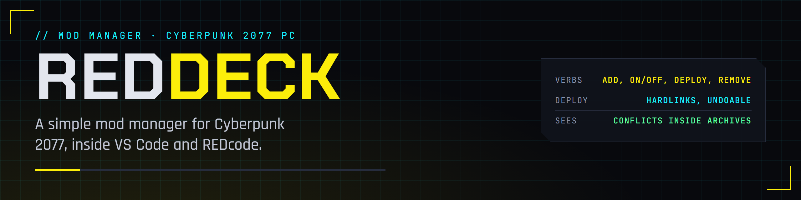
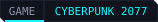
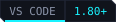

<p align="center">
  
</p>

<p align="center">
  <a href="https://edgemodders.github.io/REDdeck/"></a>
  
  
  
  <a href="LICENSE"></a>
</p>

A mod manager for Cyberpunk 2077 that lives inside VS Code and [REDcode](https://github.com/Edgemodders/REDcode). One list of mods, four verbs, no jargon.

REDdeck keeps your mods in a library outside the game folder, deploys the ones you turn on with hardlinks, and undoes it just as cleanly. It recognises the frameworks (RED4ext, CET, redscript, ArchiveXL, TweakXL and friends), prepares REDmod packages, writes the archive load order, and, with [REDbridge](https://github.com/Edgemodders/REDbridge) present, shows conflicts between files *inside* mod archives, which file-level managers cannot see. The name: a deck of mods, a nod to the cyberdeck, and the mods waiting "on deck" before you deploy them.

**[Read the docs](https://edgemodders.github.io/REDdeck/)** &middot; [Design](https://edgemodders.github.io/REDdeck/design.html) &middot; [REDcode](https://github.com/Edgemodders/REDcode) &middot; [REDbridge](https://github.com/Edgemodders/REDbridge) &middot; [REDnode](https://github.com/Edgemodders/REDnode)

> [!NOTE]
> **Status: M1 to M5 built in one day, awaiting a real-game test.** Add from zip, 7z, rar, folder or Nexus link; hardlink deploy with a manifest, undo and backups; changes made outside REDdeck; conflicts by order with `modlist.txt`; import from Vortex; a detail panel; conflicts inside archives through REDbridge; REDmod deploy; Nexus update checks and nxm download links; a project's packed output as a mod that follows the project; loadouts; a `reddeck` command line with `--json`. `npm run test:ui` runs it all inside a real VS Code. The core passes `npm run smoke` against a fake game folder, a real Vortex library and a real REDbridge; the Nexus calls themselves have not been run against a live account yet. The [design](https://edgemodders.github.io/REDdeck/design.html) has the full picture.

## How it works

```
 Library (outside the game)            REDdeck (VS Code extension)           Game folder
 ┌───────────────────────────┐         ┌───────────────────────────┐         ┌──────────────────────────┐
 │ one folder per mod, laid  │  deploy │ Mods view: on/off, status │ hardlink│ archive/pc/mod/          │
 │ out exactly as it deploys │────────►│ classifier: kind + target │────────►│ r6/scripts, r6/tweaks    │
 │ mod.json, library.json    │◄────────│ deployer: manifest, undo  │◄────────│ red4ext/plugins, mods/   │
 │ downloads/ (originals)    │  undo   │ Nexus client, nxm links   │ verify  │ bin/x64/plugins/cet/mods │
 └───────────────────────────┘         └───────────────────────────┘         └──────────────────────────┘
                                       optional: REDcode (install a packed project), REDbridge (archive conflicts)
```

| You do | REDdeck does |
|---|---|
| **Add** a zip, 7z, rar, folder or Nexus link | Works out what kind of mod it is and where its files go. Asks only when it cannot tell. With REDdeck handling nxm links, the Mod manager download button on Nexus lands the file in the library. |
| Turn a mod **on** or **off** | Nothing on disk yet. The Deploy button counts the changes waiting. |
| **Deploy** | Hardlinks the enabled mods into the game, writes the load order, prepares REDmod packages, records a manifest. |
| **Remove** | Deletes the mod from the library. Deployed files come out on the next deploy. |
| Undo deploy | Removes every file in the manifest and nothing else. |

## Repository layout

| Path | Contents |
|---|---|
| `src/` | The extension. `core.ts` gathers the VS Code-free parts: classifier, library, deploy, extract, vortex |
| `bin/reddeck.mjs` | The command line over the same core |
| `scripts/smoke.mjs` | End-to-end test of the core against a fake game folder |
| `images/` | Activity bar icon and extension icon |
| `docs/` | Documentation site |
| `tools/brand/` | Generates the banner, badges and icon |

## Build

```powershell
git clone https://github.com/Edgemodders/REDdeck.git
cd REDdeck
npm install
npm run build       # or: npm run watch
npm run smoke       # classify, add, deploy, undo against a temp folder
```

Open the folder in VS Code and press F5 to run the extension in a second window. Details in the [setup guide](https://edgemodders.github.io/REDdeck/dev-setup.html).

## Command line

```
node bin/reddeck.mjs list                      # what is in the library and its status
node bin/reddeck.mjs add "C:\Downloads\Mod.zip" --name "My Mod"
node bin/reddeck.mjs on my-mod && node bin/reddeck.mjs deploy
node bin/reddeck.mjs conflicts --json          # every command prints JSON with --json
```

`--library` and `--game` override the folders. The library's JSON files are the only state, so an assistant can read them directly and use the command line to act.

## Roadmap

- **M0 Decide.** Name, repository, the word list, the extension scaffold.
- **M1 Library.** Add from archives and folders, the library layout, hardlink deploy with manifest and undo, changes made outside REDdeck, Vortex detection and import.
- **M2 Kinds.** Frameworks group with game version check, REDmod packages, file and archive conflicts with reorder.
- **M3 Nexus.** Sign in (single sign-on once Nexus registers the app, paste a key until then), mod metadata, updates, nxm links.
- **M4 Loop.** Install and test a REDcode project with one click. REDnode packages as a mod kind.
- **M5 Share.** Loadouts, a `reddeck` CLI, MCP tools, publish to Open VSX and the Marketplace.

## Relation to Vortex

Vortex works and supports two hundred games. REDdeck supports one, so it can leave out profiles, activators, phases and the thirty-odd installer rules that make Vortex feel heavy for Cyberpunk. It keeps the parts that are unavoidable: a library outside the game, a deployment manifest, detection of changes made outside the manager, load order, conflicts and Nexus links. REDdeck refuses to deploy while Vortex manages the same game folder, and can import Vortex's library.

## Legal

MIT. This repository contains no game files, no mod files and no data extracted from the game. Single-player modding only. Nexus Mods is used through its public API under its acceptable use policy. REDmod, REDengine and Cyberpunk 2077 are CD PROJEKT's. A cyberdeck is theirs too; a deck of mods is ours.

## License

[MIT](LICENSE)
